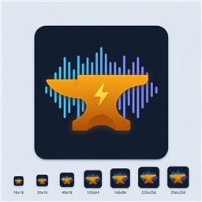

<div align="center">



# VoxForge

**Standalone Rust + Tauri v2 Desktop App, Zero-Shot Voice Cloning & Neural TTS Studio**

[](https://github.com/AMG555/VoxForge/releases/latest)
[](https://github.com/AMG555/VoxForge/releases)

[](docs/architecture.md)
[](#license)
[](https://www.rust-lang.org)
[](https://v2.tauri.app)
[](docs/api.md)
[](docs/architecture.md)

*An open-source, private, self-hosted neural speech workstation and native desktop app in Rust. Zero-Python core startup with native Piper C++, 646+ language zero-shot cloning, Cantonese/global neural voices, optional PyTorch extensions (Chatterbox-Turbo, KittenTTS 2, F5-TTS, Canto-TTS, Kokoro), broadcast DSP mastering, and MCP server.*

[Downloads](#-direct-downloads--instant-setup) • [Features](#-key-capabilities) • [Installation Guide](docs/installation.md) • [User Manual](docs/user-guide.md) • [Architecture](docs/architecture.md) • [API Spec](docs/api.md) • [Wireframes](docs/wireframes.md) • [Hardware Tiers](#hardware-profiler)

</div>

---

> [!NOTE]
> **Project Status: Standalone Desktop + API v0.7.1**  
> Built as a 15-crate Rust workspace with a native **Tauri v2 Desktop App** (`voxforge-desktop`) + CLI/API daemon (`voxforge`): zero-Python startup (`Native Rust Core` + 1-click standalone native Piper C++ runtime) plus optional PyTorch sidecar engines (Chatterbox-Turbo, Chatterbox-23Lang, KittenTTS 2, F5-TTS, Canto-TTS, OmniVoice, CosyVoice, Kokoro), zero-shot voice cloning across 646 languages, voice blend studio, Whisper ASR, visual DAG pipeline builder, 17-tool MCP server, SHA-256 verified auto-updater, and OpenAI-compatible API. All 15 crates pass automated tests.

> [!TIP]
> **100% Local & Privacy Guaranteed**  
> All neural voice synthesis, cloning, and transcription execute directly on your machine. Zero telemetry, zero audio streaming to external clouds, zero tracking. Fully functional offline.

---

## ⚡ Quick Start — Run in 1 Step

### 🤖 1-Prompt Setup for Any AI Agent (Cursor, Claude Code, Windsurf, Antigravity)

Running an AI coding assistant? Copy-paste this single prompt to have your agent clone, build, launch, and verify VoxForge automatically:

```text
Clone https://github.com/AMG555/VoxForge.git, navigate into VoxForge, launch the speech synthesis server and visual workstation (run `cargo run --bin voxforge` or use `./run.bat` on Windows / `./run.sh` on macOS/Linux; fallback to `npx github:AMG555/VoxForge` or `docker compose up -d` if no Rust compiler is installed), and verify that http://localhost:8080/health returns status ok.
```

---

### 🚀 Instant Run for Humans

| Method | Command | What It Does |
| :--- | :--- | :--- |
| **Instant (Zero Install)** | `npx github:AMG555/VoxForge` | Auto-detects OS, downloads pre-built binary, launches server & opens browser |
| **Clone & Run (Cargo)** | `git clone https://github.com/AMG555/VoxForge.git`<br>`cd VoxForge && cargo run --bin voxforge` | Builds Rust daemon + embedded React 19 UI, opens `http://localhost:8080` |
| **Windows 1-Click** | Double-click `run.bat` | Auto-detects MSVC compiler, builds & opens workstation |
| **Linux / macOS 1-Click** | `./run.sh` | Shell launcher for workstation daemon |
| **Docker Container** | `docker compose up -d` | Builds and launches container with backend, embedded UI & Postgres |

---

## 📦 System Install & 🗑️ Clean Uninstall

Install standalone binary into system PATH or cleanly remove it with 1 command:

| Platform | 1-Line Terminal Install | 1-Line Clean Uninstall |
| :--- | :--- | :--- |
| **Windows (PowerShell)** | `irm https://raw.githubusercontent.com/AMG555/VoxForge/main/scripts/install.ps1 \| iex` | `irm https://raw.githubusercontent.com/AMG555/VoxForge/main/scripts/uninstall.ps1 \| iex` |
| **Linux & macOS** | `curl -fsSL https://raw.githubusercontent.com/AMG555/VoxForge/main/scripts/install.sh \| sh` | `curl -fsSL https://raw.githubusercontent.com/AMG555/VoxForge/main/scripts/uninstall.sh \| sh` |
| **Cloned Repo** | Run `./run.bat` (Win) or `./run.sh` (Unix) | Run `./uninstall.bat` (Win) or `./uninstall.sh` (Unix) |

> [!TIP]
> **Need to delete models and voice profiles too?** Pass `-PurgeData` (Windows PowerShell: `.\scripts\uninstall.ps1 -PurgeData`) or `--purge-data` (Linux/macOS: `./scripts/uninstall.sh --purge-data`).

---

## ✨ Key Capabilities

- **🎙️ Unified Multi-Engine Speech Synthesis**: Abstract local neural and cloud speech engines (OmniVoice, CosyVoice 3, Kokoro-82M, Piper ONNX, Edge-TTS, and OpenAI Router) behind a single OpenAI-compatible API (`/v1/audio/speech`).
- **🧬 Zero-Shot Voice Cloning & Voice Lab**: Extract 512-D neural speaker identity embeddings from 3-second reference audio (`POST /v1/voices/clone`). Includes 80Hz Butterworth filtering, adaptive energy VAD, peak normalization (-0.5 dBFS), 5-axis Director AI controls, and portable `.voxpersona` bundle sharing.
- **🌐 646+ Languages & Cross-Lingual Synthesis**: Synthesize speech across 646+ languages and dialects with native Unicode script detection (Devanagari, Arabic, CJK, Malayalam, Cyrillic, Latin) and automatic RTL text alignment.
- **🔀 Voice Blend Studio & Biometric Verification**: Interpolate continuous acoustic speaker embeddings between two voice profiles with spherical linear interpolation (`POST /v1/voices/profiles/blend`), and verify speaker identity similarity across 5 acoustic dimensions (`POST /v1/voices/verify`).
- **🎛️ Visual DAG Pipeline Studio**: Infinite node canvas with focal zoom (`0.25x` to `2.5x`), Kahn's topological execution, magnetic snapping, multi-node clipboard copying (`Ctrl+C`), video dubbing time-stretching (WSOLA), and audiobook resumption checkpointing (`resume.json`).
- **🤖 Model Context Protocol (MCP) Server**: Built-in JSON-RPC 2.0 server over `stdio` and Streamable HTTP (`POST`/`GET /mcp`) providing 17 speech tools, 4 resource streams, and 2 prompts with 1-click config export in the Studio navbar (`MCP Bridge`) for Claude Desktop, Cursor, Google Antigravity, and Windsurf.
- **🔄 Enterprise Release & Auto-Update Manager**: Built-in GitHub Releases checker (`GET /v1/system/update`) and SHA-256 verified atomic binary self-updater (`voxforge update --yes` and in-app Release Manager modal).
- **🎧 Studio Broadcast DSP Mastering**: Two-pass EBU R128 LUFS loudness normalization (-16 LUFS voice target), true 5ms look-ahead brickwall limiter, slow phrase leveler with speech gate, and room-tone gap filling.
- **🛡️ Enterprise Hardware Profiler**: Automated hardware detection for AVX2/AVX-512, NVIDIA CUDA, and Apple MPS; SLA policy routing; real-time Acoustic Echo Cancellation (NLMS); and spread-spectrum acoustic watermarking (`0x5658`).

---

## 📥 Direct Downloads & Instant Setup

Pre-compiled, standalone release binaries with the embedded React 19 UI:

| Platform | Download | Package Format | Details |
| :--- | :--- | :--- | :--- |
| **Windows 10 / 11 (Installer)** | [**Download Setup (.exe)**](https://github.com/AMG555/VoxForge/releases/latest/download/VoxForge_Setup_x64.exe) | Setup Wizard (`.exe`) | Installs native Desktop App (`voxforge-desktop.exe`), CLI (`voxforge.exe`) & Start Menu shortcuts |
| **Windows 10 / 11 (Zip Bundle)** | [**Download VoxForge-Windows-x64.zip**](https://github.com/AMG555/VoxForge/releases/latest/download/VoxForge-Windows-x64.zip) | Portable Bundle (`.zip`) | Includes native Desktop App (`voxforge-desktop.exe`), CLI (`voxforge.exe`), and launcher |
| **Windows 10 / 11 (Portable CLI .exe)** | [**Download voxforge.exe**](https://github.com/AMG555/VoxForge/releases/latest/download/voxforge.exe) | Portable Executable | Single zero-install headless/browser daemon & CLI binary with embedded studio UI |
| **macOS (Universal)** | [**Download Universal (.tar.gz)**](https://github.com/AMG555/VoxForge/releases/latest/download/voxforge-macos-universal.tar.gz) | Universal Tarball | Native Desktop (`voxforge-desktop-macos-universal`) & CLI (`voxforge-macos-universal`) for Apple Silicon + Intel |
| **Linux (x86_64)** | [**Download .tar.gz**](https://github.com/AMG555/VoxForge/releases/latest/download/voxforge-linux-x86_64.tar.gz) | Tarball Archive | Native Desktop (`voxforge-desktop-linux-x86_64`) & CLI (`voxforge-linux-x86_64`) executables |
| **Integrity Checksums** | [**checksums.txt**](https://github.com/AMG555/VoxForge/releases/latest/download/checksums.txt) | SHA-256 Signatures | Verify asset integrity across all releases |

> **ℹ️ Note on Windows SmartScreen / Browser Warnings:**
> VoxForge is a 100% open-source utility built transparently on GitHub Actions. Because it does not carry an expensive ($400/yr) proprietary corporate Authenticode certificate, Windows Defender SmartScreen or Chromium browsers may show an "Unrecognized app" notice on new releases:
> * **Browser Download Notice**: Click `...` next to download -> **Keep** -> **Keep anyway**.
> * **SmartScreen Popup**: Click **More info** -> **Run anyway**.
> * **Instant Unblock via PowerShell**: Run `Unblock-File .\voxforge.exe` or use the [1-line installer](#-system-install--clean-uninstall) above.

---

## System Architecture

VoxForge is built as a high-performance modular workspace in Rust:

```
                          ┌────────────────────────┐
                          │   Client Application   │
                          │ (OpenAI SDK / Web / UI)│
                          └───────────┬────────────┘
                                      │ HTTP / WebSocket
                                      ▼
┌────────────────────────────────────────────────────────────────────────┐
│                              VOXFORGE DAEMON                            │
│                                                                        │
│  ┌───────────────────────┐             ┌────────────────────────────┐  │
│  │     voxforge-api       │             │      voxforge-hardware      │  │
│  │ (Axum 0.8 / Security) │             │ (CUDA/MPS/AVX Auto-Detect) │  │
│  └───────────┬───────────┘             └─────────────┬──────────────┘  │
│              │                                       │                 │
│              ▼                                       ▼                 │
│  ┌───────────────────────┐             ┌────────────────────────────┐  │
│  │   voxforge-pipeline    │◄────────────┤      Engine Scheduler      │  │
│  │  (DAG Graph Runner)   │             │   (Tiered Auto-Fallback)   │  │
│  └───────────┬───────────┘             └─────────────┬──────────────┘  │
│              │                                       │                 │
│              ▼                                       ▼                 │
│  ┌───────────────────────┐             ┌────────────────────────────┐  │
│  │     voxforge-audio     │             │       voxforge-engine       │  │
│  │ (Normalizer/WAV/MP3)  │◄────────────┤  (Piper/Kokoro/Edge/Qwen)  │  │
│  └───────────┬───────────┘             └────────────────────────────┘  │
│              │                                                         │
│              ▼                                                         │
│  ┌──────────────────────────────────────────────────────────────────┐  │
│  │                           voxforge-core                           │  │
│  │       (DataStore Trait: SQLite / PostgreSQL / Supabase)          │  │
│  └──────────────────────────────────────────────────────────────────┘  │
└────────────────────────────────────────────────────────────────────────┘
```

For complete technical specifications, sequence diagrams, and lifecycle documentation, refer to:
- [Installation Guide](docs/installation.md)
- [User Manual & CLI Reference](docs/user-guide.md)
- [Architecture Deep-Dive](docs/architecture.md)
- [Model Context Protocol (MCP) Integration](docs/mcp.md)
- [UI/UX Wireframes & Component Specs](docs/wireframes.md)
- [REST & WebSocket API Reference](docs/api.md)
- [Architecture Decision Records (ADRs)](docs/decisions/)

---

## 🛠️ Integrations & Developer Tools

### 1. AI Agent Integration via Model Context Protocol (MCP)

Connect Claude Desktop, Cursor, Google Antigravity, Windsurf, or Roo Code directly to VoxForge with zero manual compilation:

**Zero-Install via NPX (works out of the box on Windows, macOS & Linux):**
```json
{
  "mcpServers": {
    "voxforge": {
      "command": "npx",
      "args": ["-y", "github:AMG555/VoxForge", "mcp"]
    }
  }
}
```

**Or using the installed `voxforge` binary (or `cargo run` from source):**
```json
{
  "mcpServers": {
    "voxforge": {
      "command": "voxforge",
      "args": ["mcp"]
    }
  }
}
```
*Equips AI agents with 17 speech tools (`synthesize_speech`, `clone_voice`, `refine_voice`, `transcribe_audio`, `speech_to_speech`, `execute_pipeline`, `manage_pronunciation`, `refine_text`, `embed_watermark`, `verify_watermark`, `list_voices`, `list_models`, `install_model`, `benchmark_engine`, `get_cluster_status`, `check_audio`, `parse_manuscript`), 4 resource streams, 2 prompts, and Streamable HTTP/SSE on `http://localhost:8080/mcp`.* See the [MCP Integration Guide](docs/mcp.md).

---

### 2. Docker Containers (All-in-One & Neural Stack)

Launch the unified container (backend + embedded visual UI) from a cloned repository:

```bash
docker compose up -d
```
Or start multi-service stack with persistent database and neural microservices:
```bash
docker compose -f docker-compose.neural.yml up -d
```

---

### 3. Run Single Binary (CLI)

Download the release binary for your platform or build from source:

```bash
# Build binary
cargo build --release --bin voxforge

# Verify hardware environment
./target/release/voxforge hardware

# Run automated QA A/B benchmark between voices
./target/release/voxforge ab-test --iterations 3

# Start Model Context Protocol (MCP) server for LLM agents
./target/release/voxforge mcp

# Launch HTTP/WS server
./target/release/voxforge serve --port 8080 --data-dir ./data
```

### 4. OpenAI Drop-In Replacement

VoxForge provides a drop-in replacement for the OpenAI Audio Speech API (`/v1/audio/speech`).

Using `curl`:

```bash
curl http://localhost:8080/v1/audio/speech \
  -H "Authorization: Bearer dev-key-123" \
  -H "Content-Type: application/json" \
  -d '{
    "model": "edge-tts",
    "input": "VoxForge is now operational with hardware-accelerated speech synthesis.",
    "voice": "en-US-ChristopherNeural",
    "response_format": "wav",
    "speed": 1.0
  }' \
  --output test.wav
```

Using the official OpenAI Python SDK:

```python
from openai import OpenAI

client = OpenAI(
    base_url="http://localhost:8080/v1",
    api_key="dev-key-123"
)

response = client.audio.speech.create(
    model="edge-tts",
    voice="en-US-AriaNeural",
    input="Streaming low-latency audio via VoxForge engine."
)

response.stream_to_file("speech.wav")
```

---

### 5. n8n Workflow Automation Integration

Connect VoxForge to [n8n](https://n8n.io) to automate speech pipelines, customer voice replies, and multi-speaker podcast generation:

- **OpenAI Node (Drop-in)**: Point your n8n OpenAI node's Base URL to `http://localhost:8080/v1` to generate speech without changing your existing workflow logic.
- **HTTP Request Node**: Invoke `POST http://localhost:8080/v1/audio/speech` with response format set to `File (Binary)` to dispatch audio to Telegram, WhatsApp, Slack, or Discord bots.
- **Webhook DAG Execution**: Trigger full multi-speaker DAG pipelines with `POST http://localhost:8080/v1/pipeline/execute` passing exported pipeline JSON.
- **Automated Voice Cloning**: Conditionally clone caller voices via `POST http://localhost:8080/v1/voices/clone`.

---

## Hardware Profiler

VoxForge inspects your host hardware on startup to tier model selection automatically:

| Tier | Minimum Specifications | Recommended Engines | Latency (TTFB) |
|---|---|---|---|
| **Tier 1: Minimal** | 2 CPU Cores, 2GB RAM | `edge-tts` (Cloud Relay), `espeak-ng` | ~120ms |
| **Tier 2: Standard** | 4 CPU Cores (AVX2), 4GB RAM | `piper` (medium), `kokoro-82m` (ONNX CPU) | ~85ms |
| **Tier 3: Pro** | 8 CPU Cores, 16GB RAM / 4GB VRAM | `kokoro-82m` (GPU), `kittentts`, `piper` (high) | ~35ms |
| **Tier 4: Enterprise** | NVIDIA GPU >= 12GB VRAM (CUDA) | `qwen3-tts`, `chat-tts`, `styletts2` | ~45ms |

To inspect system capability:

```bash
voxforge hardware probe
```

Output:
```
[INFO] Hardware Analysis:
  - CPU: AMD Ryzen 9 5900X (24 threads) [AVX2: YES, AVX-512: NO]
  - Memory: 32768 MB total (24120 MB free)
  - Accelerators Detected:
    * NVIDIA GeForce RTX 3080 (10240 MB VRAM) [CUDA 12.4]
  - Assigned Profile: TIER_4_ENTERPRISE
  - Default Local Engine: kokoro-82m-cuda
```

---

## Visual Pipeline Nodes

The visual workflow editor (`ui/`) supports real-time DAG composition:

- **Text Input / Ingestion**: Raw text, Markdown parser, SSML injector, Document chunker.
- **Voice Allocation**: Regex-based speaker detection (`Alice: ...`, `Bob: ...`), dynamic voice assigner.
- **Audio Processing**: Pitch shift, tempo scale, stereo panning, dynamic range compressor.
- **Assembly**: Concatenation with configurable crossfades, background music ducking, stem export.

---

## Project Structure

```
voxforge/
├── Cargo.toml                  # Virtual workspace manifest
├── README.md                   # Project overview & documentation index
├── docker-compose.yml          # Container configuration
├── docs/
│   ├── architecture.md         # Full architecture diagrams & specifications
│   ├── wireframes.md           # Visual UI specifications & layout blueprints
│   ├── api.md                  # REST & WebSocket API documentation
│   └── decisions/              # Architecture Decision Records (ADR-001 - 005)
├── crates/
│   ├── voxforge-core/           # Domain models, DataStore trait, error taxonomy
│   ├── voxforge-hardware/       # CPU/GPU hardware detection & tier assignment
│   ├── voxforge-engine/         # TTS Engine traits, registry, Edge-TTS, Qwen3 zero-shot cloning
│   ├── voxforge-router/         # SLA policy routing and multi-objective scoring
│   ├── voxforge-pronunciation/  # Text normalization and custom pronunciation dictionary
│   ├── voxforge-audio/          # Audio manipulation, transcoding, DSP & metrics
│   ├── voxforge-pipeline/       # DAG execution engine, time stretch, dubbing/audiobook templates
│   ├── voxforge-benchmark/      # Engine benchmarking sentence suite & scorecard store
│   ├── voxforge-worker/         # Distributed cluster worker pool & lease management
│   ├── voxforge-asr/            # Automated Speech Recognition abstraction, Whisper, VAD
│   ├── voxforge-catalog/        # Open-weights model catalog & hardware validation
│   ├── voxforge-mcp/            # Model Context Protocol JSON-RPC 2.0 stdio server
│   ├── voxforge-api/            # Axum REST & WebSocket server, OpenAPI 3.1, metrics
│   └── voxforge-cli/            # Unified CLI binary (serve, synth, hardware, bench, ab-test, mcp)
└── ui/                         # React 19 + TypeScript + Tailwind UI
```

---

## Development & Testing

### Prerequisites

- Rust 1.80+ (`cargo`, `rustc`)
- Node.js 20+ & pnpm (for Web UI development)
- SQLite3 / PostgreSQL (optional for local database verification)

### Running Rust Workspace Tests

The workspace features a comprehensive 360+ automated test suite covering acoustic quality metrics, DAG scheduling, topological sorting, storage isolation, hardware tiering, voice cloning, SSRF/update integrity verification, ASR transcriptions, model catalogs, MCP protocol, and REST/WebSocket API endpoints:

```bash
# Run all unit and integration tests across crates (120+ tests)
cargo test --workspace

# Run dedicated audio metrics and QA benchmark tests
cargo test -p voxforge-audio --lib metrics
cargo test -p voxforge-engine --lib ab_test
cargo test -p voxforge-api --lib tests

# Run security linting
cargo clippy --workspace -- -D warnings
```

---

## Security Policy

VoxForge treats audio generation security with enterprise rigor:
- **No Client Secrets**: API keys, storage bucket credentials, and master configurations are strictly server-side.
- **Input Sanitization**: Text and SSML input is validated against injection attacks and buffer overrun limits.
- **Path Traversal Protection**: Export directories, custom audio models, and voice assets are strictly scoped to designated storage roots.
- **Rate Limiting**: Configurable token bucket rate limiting prevents denial-of-service on local inference engines.

To report security vulnerabilities, please contact `amgt503@gmail.com`.

---

## License

This project is dual-licensed under:
- **Apache License, Version 2.0** ([LICENSE-APACHE](LICENSE-APACHE))
- **MIT License** ([LICENSE-MIT](LICENSE-MIT))

You may choose either license at your option.
