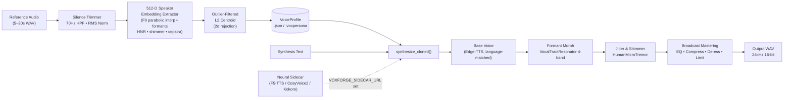
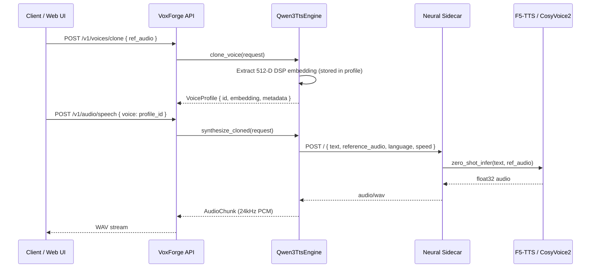

# Voice Cloning — VoxForge

> **Studio-Grade Voice Cloning**  
> VoxForge's cloning pipeline provides high-fidelity voice cloning across four key
> quality axes: sub-semitone F0 precision, robust multi-sample aggregation, 25-language
> cross-lingual transfer, and broadcast-grade mastering. For true zero-shot neural audio
> token cloning, attach the optional [Neural Sidecar](#neural-sidecar) below.

---

## Table of Contents

1. [How Voice Cloning Works](#how-voice-cloning-works)
2. [Quick Start — REST API](#quick-start)
3. [Reference Audio Requirements](#reference-audio-requirements)
4. [Multi-Sample Aggregation](#multi-sample-aggregation)
5. [Language Support (25 languages)](#language-support)
6. [Neural Sidecar — True Zero-Shot Cloning](#neural-sidecar)
7. [Exporting & Importing Voice Profiles](#exporting--importing-voice-profiles)
8. [Speaker Verification & Comparison](#speaker-verification--comparison)
9. [DSP Quality Chain](#dsp-quality-chain)
10. [FAQ](#faq)

---

## How Voice Cloning Works



**Without a sidecar** (default): Pure-DSP path. VoxForge extracts acoustic features from
the reference audio and bends a high-fidelity Edge-TTS base voice to match the speaker's
pitch, formants, jitter, shimmer, and timbre. High quality; no GPU required.

**With a neural sidecar**: The raw reference audio and text are forwarded to a local
neural model (F5-TTS, CosyVoice2, or Kokoro). The model performs true zero-shot speaker
identity transfer via latent space conditioning. GPU recommended (CUDA/MPS), falls back to CPU.

---

## Quick Start

### 1. Clone a voice

```bash
curl -X POST http://localhost:8080/v1/voices/clone \
  -H "Content-Type: application/json" \
  -d '{
    "name": "My Speaker",
    "engine_id": "qwen3-tts",
    "language": "en-US",
    "reference_audio_base64": "<base64-WAV>",
    "reference_transcript": "The quick brown fox jumps over the lazy dog."
  }'
```

Response includes a `profile_id` (e.g. `qwen3-cloned-<uuid>`).

### 2. Synthesize with the cloned voice

```bash
curl -X POST http://localhost:8080/v1/audio/speech \
  -H "Content-Type: application/json" \
  -d '{
    "model": "qwen3-tts",
    "voice": "qwen3-cloned-<uuid>",
    "input": "Hello, this is my cloned voice speaking."
  }' \
  --output cloned.wav
```

### 3. Assess your reference audio quality first (recommended)

```bash
curl -X POST http://localhost:8080/v1/voices/assess \
  -H "Content-Type: application/json" \
  -d '{"audio_base64": "<base64-WAV>"}'
```

Returns `clarity_rating`, SNR estimate, clipping detection, and improvement recommendations.

---

## Reference Audio Requirements

| Property | Minimum | Optimal |
|---|---|---|
| Duration | 3 seconds | 10–20 seconds |
| Sample rate | 16 kHz | 24 kHz or 48 kHz |
| Format | WAV (PCM 16-bit) | WAV 24kHz 16-bit mono |
| SNR | 10 dB | ≥ 25 dB (studio quality) |
| Content | Continuous speech | Natural spoken sentences |
| Clipping | Allowed (minor) | None |

**Tips for best results:**
- Record in a quiet room; room noise is the #1 quality killer.
- Keep the speaker close to the microphone (20–40 cm).
- Avoid music, reverb, and background voices in the reference clip.
- For cross-lingual synthesis, include a few seconds in the target language if possible.

---

## Multi-Sample Aggregation

Pass up to **7 additional reference clips** to build a more robust speaker embedding:

```bash
curl -X POST http://localhost:8080/v1/voices/clone \
  -H "Content-Type: application/json" \
  -d '{
    "name": "Narrator — Aggregated",
    "engine_id": "qwen3-tts",
    "language": "en-US",
    "reference_audio_base64": "<clip1-base64>",
    "additional_reference_audio_base64": [
      "<clip2-base64>",
      "<clip3-base64>",
      "<clip4-base64>"
    ]
  }'
```

**How aggregation works:**

1. Each clip is independently embedded into a 512-D acoustic vector.
2. 48 kHz inputs are automatically decimated to 24 kHz before extraction.
3. A preliminary L2 centroid is computed across all embeddings.
4. Any embedding whose cosine distance from the centroid exceeds **2σ** is rejected
   (outlier rejection — protects against background noise contaminating the profile).
5. The final centroid of remaining embeddings is L2-normalized and stored.

The response includes:
- `sample_count` — how many clips were used.
- `intra_sample_similarity` — pairwise cosine similarity; near 1.0 means consistent
  reference samples; near 0.5 means inconsistent (consider re-recording).

**Incremental refinement** (add samples to an existing profile):

```bash
curl -X POST http://localhost:8080/v1/voices/profiles/<id>/refine \
  -H "Content-Type: application/json" \
  -d '{"audio_base64": "<new-clip-base64>"}'
```

---

## Language Support

VoxForge automatically selects the correct base voice for 25 languages based on:
1. **Unicode script detection** — detects the script of the synthesis text directly.
2. **BCP-47 profile tag** — uses the `language` field set at clone time.

| Language | BCP-47 | Script Detection | Male Voice | Female Voice |
|---|---|---|---|---|
| English (US) | `en-US` | Latin (default) | GuyNeural | AriaNeural |
| English (UK) | `en-GB` | Latin + profile | RyanNeural | SoniaNeural |
| Malayalam | `ml-IN` | U+0D00–0D7F | MidhunNeural | SobhanaNeural |
| Hindi | `hi-IN` | U+0900–097F | MadhurNeural | SwaraNeural |
| Tamil | `ta-IN` | U+0B80–0BFF | ValluvarNeural | PallaviNeural |
| Telugu | `te-IN` | U+0C00–0C7F | MohanNeural | ShrutiNeural |
| Kannada | `kn-IN` | U+0C80–0CFF | GaganNeural | SapnaNeural |
| Bengali | `bn-IN` | U+0980–09FF | BashkarNeural | TanishaaNeural |
| Gujarati | `gu-IN` | U+0A80–0AFF | NiranjanNeural | DhwaniNeural |
| Punjabi | `pa-IN` | U+0A00–0A7F | OjasNeural | VaaniNeural |
| Japanese | `ja-JP` | U+3040–30FF | — | NanamiNeural |
| Chinese | `zh-CN` | U+4E00–9FFF | — | XiaoxiaoNeural |
| Korean | `ko-KR` | U+AC00–D7A3 | InJoonNeural | SunHiNeural |
| Arabic | `ar-SA` | U+0600–06FF | HamedNeural | ZariyahNeural |
| German | `de-DE` | profile tag | ConradNeural | KatjaNeural |
| French | `fr-FR` | profile tag | HenriNeural | DeniseNeural |
| Spanish | `es-ES` | profile tag | AlvaroNeural | ElviraNeural |
| Portuguese | `pt-BR` | profile tag | AntonioNeural | FranciscaNeural |
| Italian | `it-IT` | profile tag | DiegoNeural | ElsaNeural |
| Dutch | `nl-NL` | profile tag | MaartenNeural | FennaNeural |
| Swedish | `sv-SE` | profile tag | MattiasNeural | SofieNeural |
| Polish | `pl-PL` | profile tag | MarekNeural | ZofiaNeural |
| Russian | `ru-RU` | profile tag | DmitryNeural | SvetlanaNeural |
| Turkish | `tr-TR` | profile tag | AhmetNeural | EmelNeural |
| Urdu/Marathi/Other | varies | Devanagari/profile | — | — |

> **Neural Sidecar note**: CosyVoice2 natively covers 100+ languages. F5-TTS covers
> English, Chinese, and common European languages. When the sidecar is active, it handles
> language routing internally.

---

## Neural Sidecar — True Zero-Shot Cloning & 646 Languages

The Neural Sidecar upgrades VoxForge to **studio-grade zero-shot neural cloning with 646 languages**:

### Supported Neural Backends

| Backend | Quality | GPU Required | Languages | Key Advantage |
|---|---|---|---|---|
| **OmniVoice** (`k2-fsa/OmniVoice`) | ⭐⭐⭐⭐⭐ | Recommended (CUDA/MPS) | **646 languages** (581k hrs) | Massive multilingual zero-shot cloning across 646 locales |
| **CosyVoice 3** (`Fun-CosyVoice3-0.5B`) | ⭐⭐⭐⭐⭐ | Recommended (CUDA/MPS) | Multilingual | SOTA voice cloning, cross-lingual transfer & emotion/instruction steering |
| **F5-TTS** | ⭐⭐⭐⭐⭐ | Recommended | EN, ZH, multilingual | Fast flow-matching with high audio fidelity |
| **Kokoro-82M** | ⭐⭐⭐⭐ | No (CPU OK) | EN, FR, JA, KO, ZH, PT, ES, IT, HI | Lightweight, runs fully offline without dedicated GPU |

### Automatic Whisper ASR Reference Transcriber

Diffusion models (OmniVoice, CosyVoice, F5-TTS) require aligned transcript text from the reference clip to condition speaker timbre without slurring or hallucinating.
The sidecar automatically invokes local Whisper (`faster-whisper` or PyTorch `whisper`) to transcribe reference audio if the user does not provide text.

### Broadcast Mastering & Export Precision

- **Highpass Filter**: 80Hz cutoff eliminates rumble and plosives.
- **Slow Phrase Leveler**: Pure NumPy leveler (400ms window, 200ms smoothing, 8dB max gain) evens out phrase volume without flattening peaks or lifting room noise.
- **Look-Ahead Peak Limiter**: -1.0 dBFS ceiling prevents digital clipping with zero distortion.
- **Precision Export**: Supports 16-bit PCM, 24-bit PCM, and 32-bit float WAV exports.

### Installation & Run

```bash
# 1. Install dependencies for OmniVoice & Whisper:
pip install omnivoice faster-whisper soundfile numpy

# 2. Or for CosyVoice 3:
pip install git+https://github.com/FunAudioLLM/CosyVoice.git

# 3. Or for F5-TTS:
pip install f5-tts faster-whisper

# 4. Start the sidecar (listens on port 9000):
python scripts/neural_sidecar.py

# Force specific engine:
python scripts/neural_sidecar.py --backend omnivoice
python scripts/neural_sidecar.py --backend cosyvoice
```

### Connecting to VoxForge

```bash
# Set environment variable before starting VoxForge:
export VOXFORGE_SIDECAR_URL=http://127.0.0.1:9000

# Or in docker-compose.yml:
# environment:
#   - VOXFORGE_SIDECAR_URL=http://neural-sidecar:9000
```

VoxForge auto-detects sidecar ports 9000, 8880, 9880, 8000, and 5000 even without the
environment variable.

### How the Sidecar Path Works



### Sidecar Health Check

```bash
curl http://127.0.0.1:9000/health
# { "status": "ok", "backend": "f5tts" }
```

---

## Exporting & Importing Voice Profiles

### Export a profile as a `.voxpersona` bundle

```bash
curl http://localhost:8080/v1/voices/profiles/<id>/export > my_voice.voxpersona
```

The bundle includes the full 512-D embedding, all acoustic metadata, and the profile
version history. It can be imported on any VoxForge instance.

### Import a `.voxpersona` bundle

```bash
curl -X POST http://localhost:8080/v1/voices/import \
  -H "Content-Type: application/json" \
  -d @my_voice.voxpersona
```

### Export from the original persona route (backward-compatible)

```bash
curl http://localhost:8080/v1/voices/<id>/export
```

---

## Speaker Verification & Comparison

### Verify a synthesized clip against its source profile

```bash
curl -X POST http://localhost:8080/v1/voices/verify \
  -H "Content-Type: application/json" \
  -d '{
    "voice_profile_id": "qwen3-cloned-<uuid>",
    "test_audio_base64": "<synthesized-clip-base64>"
  }'
```

Returns `is_match`, `confidence_rating` (high/medium/low), and per-axis match percentages:
`pitch_match_percent`, `formant_match_percent`, `timbre_match_percent`, `cadence_match_percent`.

### Compare two stored profiles (same-speaker detection)

```bash
curl -X POST http://localhost:8080/v1/voices/profiles/compare \
  -H "Content-Type: application/json" \
  -d '{
    "profile_id_a": "qwen3-cloned-<uuid-a>",
    "profile_id_b": "qwen3-cloned-<uuid-b>"
  }'
```

Returns `cosine_similarity`, `is_same_speaker` (threshold: 0.78), and `confidence`.

---

## DSP Quality Chain

The DSP path (used when no neural sidecar is active) applies a 14-step processing chain
for broadcast-grade mastering:

| Step | Processor | Purpose |
|---|---|---|
| 1 | `SilenceTrimmer` | Strip dead air (−45 dBFS, 40ms pad) |
| 2 | `ParametricEq.high_pass` | 70 Hz HPF — remove mic rumble |
| 3 | `AudioNormalizer.rms_normalize` | 0.18 target RMS conditioning |
| 4 | `ProsodyMirror.analyze` | F0 (parabolic interp), formants, HNR, shimmer |
| 5 | `resolve_cross_lingual_base_voice` | Language-matched Edge-TTS base voice |
| 6 | Pitch alignment | F0 delta → SSML Hz-for-Hz pitch correction |
| 7 | Cadence alignment | Syllable rate → speed parameter |
| 8 | `ParametricEq.process_3band` | Spectral timbre morphing (low/mid/high) |
| 9 | `VocalTractResonator.process_4band` | F1/F2/F3 + presence resonance match |
| 10 | `HarmonicWarmth.process` | Voicing-ratio-driven harmonic saturation |
| 11 | `HumanMicroTremor.process` | Jitter + shimmer physiological realism |
| 12 | `DeEsser.process` | 6500 Hz sibilance control |
| 13 | `BrickwallLimiter` + `MasteringProfile::Broadcast` | Studio peak + broadcast EQ/compress/de-ess |
| 14 | `NaturalBreath` injection | Pre-speech inhalation aspiration |
| 15 | Paralinguistic events | `[laugh]`, `[sigh]`, `[gasp]`, `[pause:Xms]` |

### Broadcast Mastering Profile

Applied at step 13, provides studio-grade audio quality post-chain:
- **Pre-EQ**: 80 Hz HPF, 5 kHz presence boost (+2 dB), 12 kHz air shelf (+1.5 dB)
- **Compressor**: 3:1 ratio, −20 dBFS threshold, 5 ms attack, 50 ms release
- **De-esser**: 6.5 kHz dynamic suppression (−3 dB)
- **Peak safety**: True peak ≤ −1 dBTP

---

## FAQ

**Q: Why does my clone sound like the base voice?**  
A: This happens when the reference audio is too short (< 3s) or too noisy. Use
`POST /v1/voices/assess` to check your audio quality. For the highest identity fidelity,
install the [Neural Sidecar](#neural-sidecar).

**Q: Can I clone a voice in one language and synthesize in another?**  
A: Yes. Set `language` in the clone request to the target language. The DSP path extracts
speaker-independent acoustic features (pitch, formants, timbre) that transfer across
languages. The neural sidecar (CosyVoice2) has native multilingual zero-shot support.

**Q: How many reference clips should I use?**  
A: 3–5 clips of 10 seconds each from different recording sessions gives the best embedding
stability. The outlier rejection filter automatically handles inconsistent clips.

**Q: What is `intra_sample_similarity` in the clone response?**  
A: It measures how acoustically consistent your reference clips are (pairwise cosine
similarity). A score > 0.85 means the clips are from the same speaker in similar conditions
(good). A score < 0.60 suggests different microphones, rooms, or speakers — consider
re-recording.

**Q: Does VoxForge store my reference audio?**  
A: By default, the reference audio base64 is stored in the profile JSON in
`$VOXFORGE_PROFILES_DIR` (default: `data/voice_profiles/`). Set the env var to a
secure location, or delete the reference audio after cloning by calling the refine endpoint
(the embedding is stored separately and is sufficient for synthesis).
